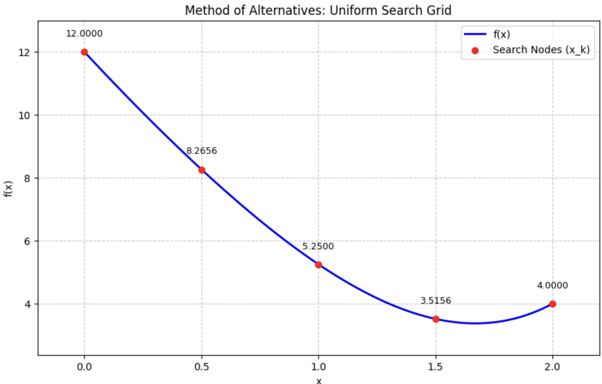

# Method of Alternatives (Uniform Search)

This implementation is based on the optimization principles for unimodal functions as outlined in the course textbook.

## Theoretical Breakdown
The **Method of Alternatives** (Uniform Search) follows these core principles to find the minimum of a function $f(x)$ on a closed interval $[a, b]$:

* **Objective**: Find the minimum of a unimodal function $f(x)$ on the interval $[a, b]$ with a precision of $\epsilon > 0$.
* **Grid Construction**: The interval $[a, b]$ is divided into $n$ equal parts.
* **Formula for Points**: The nodes are calculated as:
    $$x_k = a + k \cdot \frac{b - a}{n}, \quad k = 0, 1, \dots, n$$
* **Condition for $n$**: To ensure the error is within the required precision, $n$ must satisfy:
    $$n \ge \frac{b - a}{\epsilon}$$
* **Selection**: Function values $f(x_k)$ are calculated at each node, and the approximate global minimum is identified as:
    $$f(x_m) = \min_{k=0, \dots, n} f(x_k)$$
* **Error Bound**: The maximum error for this method is defined as:
    $$\epsilon_n = \frac{b - a}{n}$$

## Numerical Example
Based on the textbook example (Page 42):
* **Function**: $f(x) = \frac{1}{4}x^4 + x^2 - 8x + 12$
* **Interval**: $[0, 2]$
* **Precision**: $\epsilon = 0.5$
* **Calculated segments**: $n = 4$

| $x_i$ | $f(x_i)$ |
| :--- | :--- |
| 0.0 | 12.0000 |
| 0.5 | 8.2656 |
| 1.0 | 5.2500 |
| **1.5** | **3.5156** |
| 2.0 | 4.0000 |

**Result**: The approximate minimum is at $x = 1.5$.

