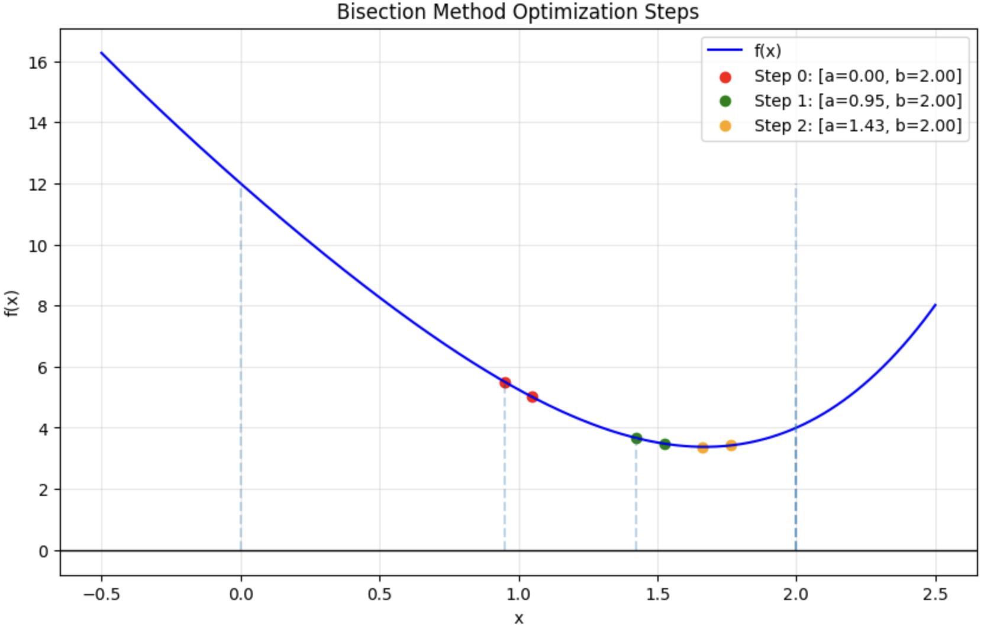

# 2.2 Half-Interval (Bisection) Method

This implementation follows the Bisection (Dichotomy) method to optimize a unimodal function by iteratively narrowing the search interval.

## Mathematical Model
Based on the textbook:
* **Objective**: Minimize $f(x)$ on $[a, b]$ with precision $\epsilon$.
* **Step Calculation**: Two points are chosen around the midpoint:
  $$x_1 = \frac{a+b-\delta}{2}, \quad x_2 = \frac{a+b+\delta}{2}$$
  where $\delta \in (0, 2\epsilon)$.
* **Selection Logic**:
  * If $f(x_1) \le f(x_2)$, the new interval is $[a, x_2]$.
  * If $f(x_1) > f(x_2)$, the new interval is $[x_1, b]$.

## Numerical Example (Page 45)
- **Function**: $f(x) = \frac{1}{4}x^4 + x^2 - 8x + 12$
- **Interval**: $[0, 2]$
- **Parameters**: $\epsilon = 0.5$, $\delta = 0.1$

### Results Table
| Step | $a_k$ | $b_k$ | $x_m$ | $f(x^*)$ |
| :--- | :--- | :--- | :--- | :--- |
| 0 | 0.0000 | 2.0000 | 1.0000 | 5.2562 |
| 1 | 0.9500 | 2.0000 | 1.4750 | 3.5695 |
| 2 | 1.4250 | 2.0000 | 1.7125 | 3.3962 |
*(Data source: Textbook Table 2.2)*

## Visualizing the Process
The following graph demonstrates how the search interval $[a, b]$ shrinks during each iteration:

### Key Observations:
* **Initial Interval**: The algorithm starts with $[0, 2]$.
* **Points $x_1, x_2$**: Two points are placed symmetrically around the center, separated by $\delta$.
* **Convergence**: By comparing $f(x_1)$ and $f(x_2)$, the method eliminates the part of the interval where the minimum cannot exist.
